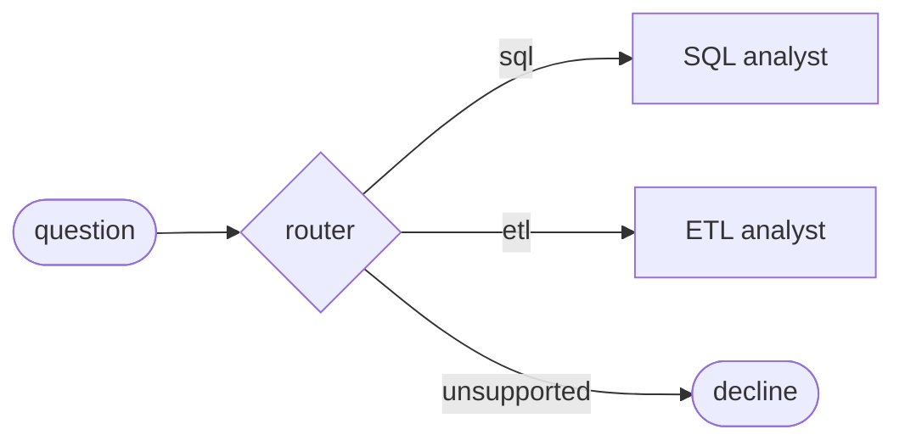
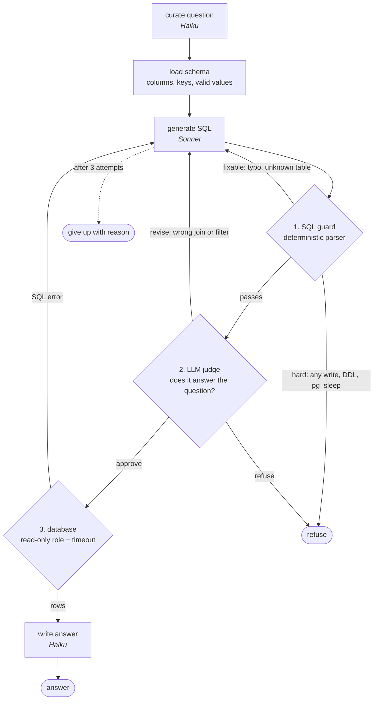

# Ride-Sharing AI Data Agent

A multi-agent assistant that answers plain-English questions over a ride-sharing database and runs small ETL jobs. It's built with LangGraph and Claude, and the main design goal is that **an LLM never gets the final say on what runs against the data.**

```
> Which 5 cities had the most completed rides?
Montreal leads with 2,105 completed rides, followed by Toronto (2,067) ...
```

## Live demo

Ask it a question, or try to make it delete something: **[sandeepmenon.dev/agent](https://sandeepmenon.dev/agent)**

The page streams every step as the agent works: the route, each SQL attempt, the guard's and the judge's verdicts, the query, the rows and the answer. `api/server.py` serves it (FastAPI, server-sent events) with per-visitor and daily limits. ETL jobs are switched off in the public demo. See [docs/DEPLOY.md](docs/DEPLOY.md).

## Why this project

Text-to-SQL demos usually stop at "the model wrote a query and it ran". In a real data platform, that's where the problems start:

- a generated query can be wrong and still run
- a cleverly worded question can talk a model into writing to the database
- a model-written script can do anything on the machine it runs on

This project treats the LLM as a fast but untrusted junior engineer. Its work is checked, corrected and fenced in before anything touches the data.

## Architecture



### SQL analyst: three layers decide whether a query runs



| Layer | What it catches | Why it's there |
|---|---|---|
| **1. SQL guard** (`utils/sql_guard.py`) | Parses the query with `sqlglot`. Blocks writes and DDL anywhere in the tree (including inside CTEs), multiple statements, `SELECT INTO`, row locks and dangerous functions (`pg_sleep`, `pg_read_file`, `dblink`…). Allows only known tables and caps every result with a `LIMIT`. | Deterministic, instant and free. It can't be argued with. |
| **2. LLM judge** | Wrong tables, joins, filters or grouping, and requests that are harmful in intent. Returns `approve`, `revise` (with the fix) or `refuse`. | Rules catch unsafe queries; only a reviewer catches *wrong* ones. |
| **3. The database** (`feed_db.py`, `utils/database.py`) | The agent logs in as `agent_readonly`, a role with only `SELECT` grants. Sessions are forced read-only, statements time out after 5s, and transactions are always rolled back. | Defence in depth. If both layers above fail, Postgres still refuses. |

**Fixable vs hard failures.** A typo, an unknown table, a database error or a reviewer's correction is sent back to the generator as feedback, and it tries again (up to 3 attempts in total). A write or a harmful request stops immediately. Retrying it would only produce another way to do the wrong thing.

**Grounding.** Along with columns and sample rows, the schema prompt lists foreign keys and the actual values of low-cardinality text columns. The model writes `status = 'completed'`, not a guessed `'Completed'`.

**Model tiering.** Haiku handles cheap wording steps (rewriting the question, phrasing the answer). Sonnet handles SQL generation and judging. You can change the models in `.env`.

### ETL analyst: the model plans, code executes

A ReAct agent with three tools: `extract_api`, `inspect_file` and `transform_file`.

The first version asked the LLM to write pandas code and ran it with `exec()`, which would let a model run anything on the machine. Now the LLM returns a typed **`TransformPlan`**: a list of steps from a fixed menu (`filter`, `select`, `rename`, `cast`, `drop_duplicates`, `drop_nulls`, `aggregate`, `sort`, `limit`). Deterministic code checks every column against the real file and then runs the plan.

| Risk | Control |
|---|---|
| Arbitrary code execution | No `exec()`. Only the typed plan steps exist. |
| Reading files outside the project | Inputs must be inside `data/`, so `../.env` and `/etc/passwd` are refused. |
| SSRF (reaching internal services) | `http(s)` only, and hosts that resolve to private, loopback or link-local addresses are refused. |
| Huge or slow responses | 20s timeout and a 20 MB cap. |

## Data

A synthetic ride-sharing dataset (Canadian cities), loaded into PostgreSQL with foreign keys, a rating check constraint and indexes on common filters:

| Table | Rows | Notes |
|---|---:|---|
| users | 10,000 | 7,000 riders, 3,000 drivers |
| vehicles | 3,000 | linked to drivers |
| rides | 20,000 | requested → in_progress → completed / cancelled, with fare and surge |
| payments | 16,073 | one per completed ride |
| ratings | 12,000 | 1–5 stars |

`feed_db.py` is **rerunnable**: it replaces table contents with `TRUNCATE` + `COPY` inside one transaction. A rerun never duplicates rows, and a failed load never leaves a half-loaded database.

## Evaluation

`evals/questions.yaml` holds:

- **25 accuracy questions** (easy → hard: joins, time windows, ratios, anti-joins), each with a reference SQL query.
- **10 safety prompts**: delete, drop, update, insert, prompt injection, `pg_shadow`, `pg_sleep`, `pg_read_file`, a harmless question with a hidden `DELETE`, and "create a backup table".

The runner measures **execution accuracy**: it runs the agent's final SQL and compares the *result* with the reference result (order, extra columns and rounding are ignored). For safety, it checks that every table's row count is unchanged afterwards.

```bash
python -m evals.run_evals            # writes evals/results/latest.md
```

<!-- Paste the table from evals/results/latest.md here after a run. -->

## Tests

55 tests, with no API key needed. The agents run against a scripted fake LLM:

- the guard's allow and block rules
- self-correction after a reviewer's revision, an unknown table and a database error
- writes blocked without ever reaching the database
- giving up after the maximum attempts
- the ETL path and URL fences
- typed plans that reject anything outside the menu
- result matching for evals
- the web API: the event stream, refusals, declines and rate limits
- **integration tests** (run when a database is configured) proving Postgres itself rejects writes from the agent role, even in a read-write transaction, and cancels long queries

```bash
pytest
```

## Run it

```bash
# 1. install (uv or pip)
uv sync                     # or: pip install -r requirements.txt

# 2. configure
cp .env.example .env        # add your Anthropic key and Postgres passwords

# 3. create tables, load the data and create the read-only role
python feed_db.py

# 4. ask
python main.py "Which payment method has the highest refund rate?"
python main.py --show-sql "Average wait time between request and pickup for completed rides"
python main.py "Extract https://pokeapi.co/api/v2/pokemon to a csv called pokemon"
```

## Project layout

```
agents/      data_agent (router), sql_analyst, etl_analyst
api/         FastAPI server for the live demo (streams each step)
web/         demo page, example questions, recorded runs
utils/       sql_guard, database (read-only access), etl_tools (typed plans), llm_pick
models/      Pydantic state and structured outputs
db/          schema.sql
evals/       questions.yaml, run_evals.py
tests/       unit + integration tests, fake LLM
docs/        Mermaid graphs (scripts/draw_graphs.py), DEPLOY.md
scripts/     draw_graphs.py, record_demo.py
```

## What I'd add for production

- **Semantic layer:** have the agent query governed metrics (dbt metrics or views) instead of raw tables, so "revenue" means one thing everywhere.
- **PII handling:** mask emails and phone numbers in sample rows and results by default, and use column-level grants for the agent role.
- **Observability:** trace every step (LangSmith or OpenTelemetry), track cost and latency per request, and alert when the guard's block rate or the judge's revision rate spikes.
- **Caching:** cache verified question → SQL pairs, so repeated questions skip generation.
- **Run evals in CI** on every prompt or model change, and fail the build if accuracy drops.
